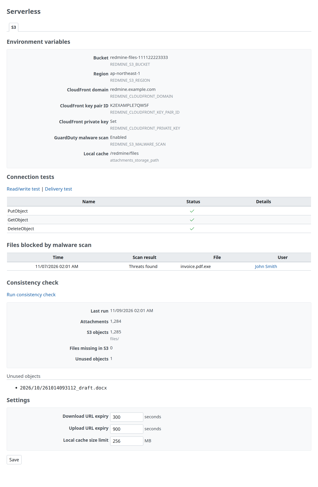

# Administration page

This is the administration page of Redmine AWS S3. Only Redmine administrators can open it (`require_admin`). The page is the "S3" tab under the "AWS" item of Redmine's administration menu, which [Redmine AWS](https://redmine-kit.github.io/redmine_aws/admin.html#the-aws-menu) adds and all the Redmine AWS plugins share.

## S3

| Section | Contents | Source |
| --- | --- | --- |
| Environment variables | "Bucket", "Region", "CloudFront domain", "CloudFront key pair ID", "CloudFront private key" ("Set" or "Not set"), "GuardDuty malware scan" ("Enabled" or "Disabled") and "Local cache". Each value has the name of its environment variable next to it, and "Local cache" has `attachments_storage_path` | Environment variables ([setup.md](setup.md#configuration)) and `config/configuration.yml`, display only. The private key itself is not shown |
| Connection tests | "Read/write test" puts a test object (`tmp/healthcheck/<UUID>`), reads it and deletes it. "Delivery test" puts a test object, makes a signed URL for it under `/tmp/bulk/`, and requests it through CloudFront, with and without the signature. The results are shown in a table with the columns Name, Status and Details ([below](#connection-tests)) | Text links. The delivery test deletes its object afterwards |
| Files blocked by malware scan | The last 20 files that the malware scan blocked, with the columns "Time", "Scan result", "File" and "User" (a link to the Redmine user). Shown when "GuardDuty malware scan" is "Enabled" or a blocked file is recorded | Kept in the plugin settings ([attachments.md](attachments.md#malware-scan)) |
| Consistency check | "Run consistency check" starts the job `AwsS3ReconcileJob`, which lists `files/` and compares it with the attachments in the database. While it runs, the box shows "Status: Running" and "Started at". When it is done, it shows "Last run", "Attachments", "S3 objects" (under `files/`), "Files missing in S3" and "Unused objects", then the lists under those two names (the first 100 of each) | A text link. The result is kept in the plugin settings, so every environment shows the latest one |
| Settings | "Download URL expiry" and "Upload URL expiry" (seconds), "Local cache size limit" (MB) | Plugin settings, changed on the page. Positive whole numbers only; invalid input is not saved and stays in the form, under an error at the top of the tab that lists the labels of the wrong fields |

The results of the connection tests:

| Name | Test | OK when |
| --- | --- | --- |
| PutObject, GetObject, DeleteObject | Read/write test | Each call succeeds, and GetObject returns what was put |
| Signed URL | Delivery test | CloudFront returns the object (200) for the signed URL |
| CSP sandbox | Delivery test | The response has a `Content-Security-Policy` with `sandbox` |
| nosniff | Delivery test | The response has `X-Content-Type-Options: nosniff` |
| Unsigned URL denied | Delivery test | The same URL without the signature returns 401 or 403 |
| Delivery | Delivery test | Shown only when the test stops with an error |

- **Failed calls:** A call that fails shows only the class of the error in the Details column (for example `Aws::S3::Errors::AccessDenied`), as the "Status" tab of Redmine AWS does. The error's message, which may name hosts, accounts or resources, is not shown on the page; Redmine's log has the test's name with the class and the message (`[redmine_aws_s3] connection test PutObject failed: …`).

- **Use:** After moving attachments from an older Redmine ([migration.md](https://redmine-kit.github.io/serverless/migration.html)), the consistency check lets you check that nothing is missing.
- **Status tab:** When the bucket is set, the "Connection test" on the "Status" tab of Redmine AWS has an "S3" row. It calls `HeadBucket` on the attachment bucket and shows the bucket name.
- **No secrets shown:** AWS credentials and the CloudFront private key are not shown. AWS APIs are called only when a link is clicked.
- **Without the bucket:** The tab still opens and shows the warning "REDMINE_S3_BUCKET is not set, so attachments are stored on the local disk." It shows the environment variables and the settings; the connection tests, the blocked files and the consistency check are not shown.
- **Operations are logged:** Changing the settings (the names of the settings, not their values), the connection tests and the consistency check are written to Redmine's log with the administrator's login.

## The AWS menu

[Redmine AWS](https://redmine-kit.github.io/redmine_aws/admin.html#the-aws-menu) adds the "AWS" item of Redmine's administration menu (`/admin/aws`, which opens the first tab), and each Redmine AWS plugin registers its tab there (`RedmineAws::Admin`). This plugin registers its tab, "S3", at position 50, and, when the bucket is set, the "S3" row (`HeadBucket`) for the "Connection test" of the "Status" tab.

- **Configure:** "Configure" of the plugin in Redmine's plugin list opens the "S3" tab.

## Maximum attachment size

Redmine's "Maximum attachment size" (`attachment_max_size`, Administration › Settings › Files) can still be changed. When the plugin is on, a small script on the settings page adds this note next to the setting: "With S3, keep the CloudFront Function (/tmp/*) limit the same. On Lambda, POST /uploads.json is limited to 1 MB". Uploads through CloudFront are limited by the CloudFront Function on `/tmp/*` (uploads under `/tmp/incoming/`), which must use the same value, and by what CloudFront accepts for one PUT; on Lambda, the REST API `POST /uploads.json` is limited to 1 MB ([attachments.md](attachments.md#upload)).

## Permissions

For the consistency check job, the role that runs jobs gets permission to list the bucket. The delivery test uses the same permissions as attachments. The list is in [iam.md](iam.md).

## Tests

The page has Redmine functional tests; system tests are not written yet ([testing.md](https://redmine-kit.github.io/serverless/testing.html#administration-pages)).

The screenshot on this page is taken with `bin/screenshots` (headless Chromium in Docker, with Redmine's test data and the S3 of the tests; the bucket, the CloudFront values, the blocked file and the consistency check are examples). Run it after changing the page.

## Terms

The screen's terms follow the Japanese of the AWS documentation where AWS has one (checked on 2026-11-10). The Japanese GuardDuty documentation is a machine translation.

| Screen (en / ja) | AWS term | Source | Status |
| --- | --- | --- | --- |
| GuardDuty malware scan / GuardDuty マルウェアスキャン | Malware scan (「マルウェアスキャン」) | https://docs.aws.amazon.com/ja_jp/guardduty/latest/ug/monitoring-malware-protection-s3-scans-gdu.html | Documentation |
| Scan result / スキャン結果 | Scan result (「スキャン結果」), the tag `GuardDutyMalwareScanStatus` | Same page | Documentation |
| Threats found / 脅威を検出 | `THREATS_FOUND` | Same page. The values stay in English. Our Japanese is made from the description 「潜在する脅威を検出しました」 | To recheck in the console |
| Unsupported / サポート対象外 | `UNSUPPORTED` | Same page. Made from the description (the scan is skipped for files that are not supported) | To recheck in the console |
| Access denied / アクセス拒否 | `ACCESS_DENIED` | Same page. Made from the description 「GuardDuty はこのオブジェクトにアクセスできず」 | To recheck in the console |
| Failed / 失敗 | `FAILED` | Same page. Made from the scan status 「失敗」 | To recheck in the console |
| Unknown / 不明 | Any other value | A value that GuardDuty may add later is shown with this label, not as the raw value | Product term |
| Bucket / バケット, S3 objects / S3 オブジェクト数 | Bucket (「バケット」), object (「オブジェクト」) | https://docs.aws.amazon.com/ja_jp/AmazonS3/latest/userguide/Welcome.html | Documentation |
| CloudFront key pair ID / CloudFront キーペア ID | Key pair ID (「キーペア ID」) | https://docs.aws.amazon.com/ja_jp/AmazonCloudFront/latest/DeveloperGuide/private-content-trusted-signers.html | Documentation |
| Consistency check / 整合性チェック | — | The product's own term; AWS has no term for it | Product term |
| Files blocked by malware scan / マルウェアスキャンでブロックしたファイル | — | "Blocked" (「ブロック」) is the product's own term for a file Redmine does not accept after the scan; GuardDuty only tags the object | Product term |
