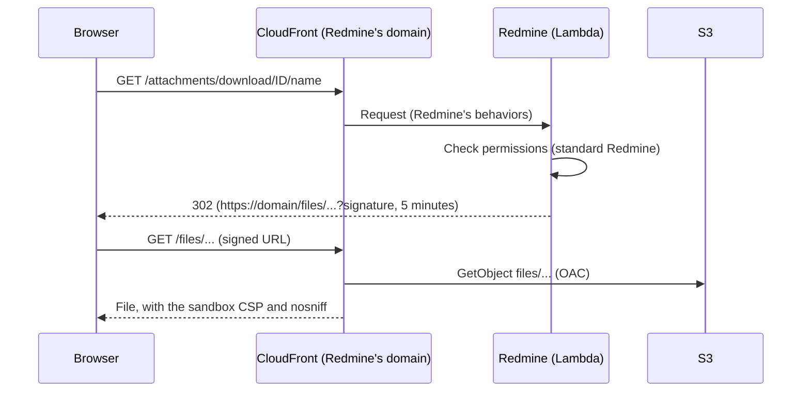
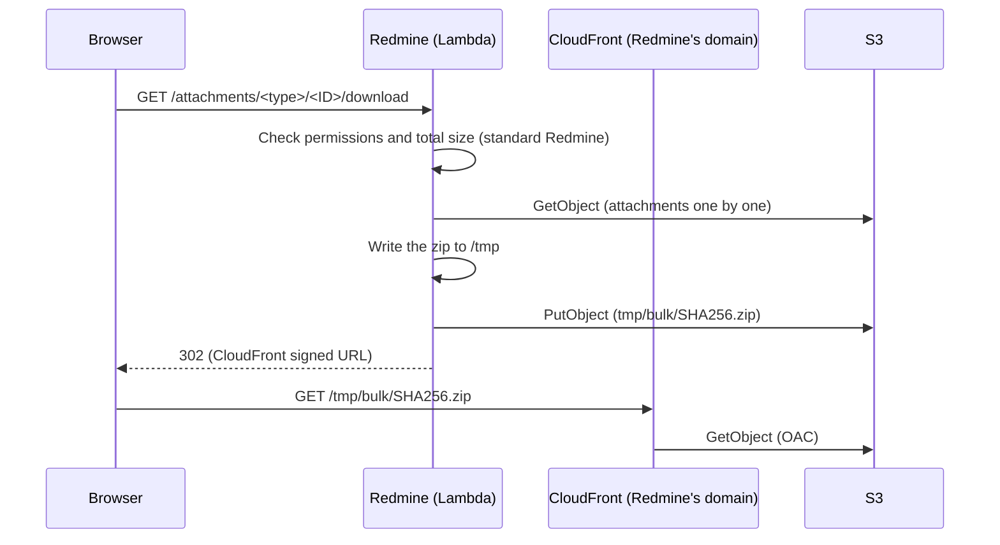

# Attachments and S3

This is how Redmine Serverless S3 stores Redmine attachments in S3. The plugin is in early development; what still needs a real CloudFront distribution to check is in [To verify](#to-verify). Browsers reach the files only through Redmine's own CloudFront distribution, never the S3 domain. Uploads are PUT through CloudFront to S3, which checks the SHA256 that the browser computed. For downloads, Redmine checks permissions, then redirects to a signed URL under `/files/`, and CloudFront reads the object from S3 and adds the same sandbox CSP as Redmine. File contents do not pass through Lambda.

It is the plugin Redmine Serverless S3 (`redmine_serverless_s3`), built following the approach of the Redmine S3 plugins below. No external plugins are installed. It also works outside Lambda, without [Redmine Serverless](https://redmine-kit.github.io/redmine_serverless/); on Lambda, [Serverless](https://redmine-kit.github.io/serverless/) installs both.

The specifications in this document were checked against official information as of 2026-11-08 and the Redmine 7.0.3 source (d718d63 on 7.0-stable). Sources are in [sources.md](https://redmine-kit.github.io/serverless/sources.html).

## How Redmine stores attachments

Redmine stores attachments on the local disk. It does not use Active Storage (loading it is commented out in `config/application.rb`).

- **Saving:** `Attachment#files_to_final_location` (`app/models/attachment.rb` L146-175) writes the file to `files/<year>/<month>/`, computes the SHA256 while writing, and stores it in `digest`. The file name is `yymmddHHMMSS_original-name`.
- **What digest is used for:** The attachment token (`<id>.<digest>`), the ETag, thumbnail file names and sharing of files with the same content all depend on `digest`.
- **Code that uses the local path:** Thumbnails (ImageMagick, Ghostscript), previews of Office files (Pandoc), images in PDF exports, downloading all attachments (zip), and showing text and diffs read the path from `Attachment#diskfile`.
- **Upload flow:** As soon as a file is selected, the browser sends the raw bytes to `POST /uploads.js` (`uploadBlob` in `app/assets/javascripts/attachments.js`). Redmine creates an attachment record not attached to anything and returns a token. When an issue or similar object is saved, the record is attached by the token.
- **Download flow:** `AttachmentsController#download` checks permissions, then returns the file with `send_file`.

On Lambda, requests and responses are limited to 6 MB, so this flow cannot handle large files as is. Function URLs base64-encode binary data, so the actual file size that can be sent is about 4.5 MB (estimate). In addition, request bodies through CloudFront are limited to 1 MB ([lambda.md](https://redmine-kit.github.io/serverless/lambda.html#the-6-mb-limit)).

## The S3 plugin used as a reference

Redmine S3 plugins all follow the same idea: they read and write through the S3 API and redirect downloads to S3 URLs. The long-standing `redmine_s3` (ka8725) is in the same line.

| Plugin | Supported Redmine | Approach |
| --- | --- | --- |
| [hgyoon-w/redmine5_amazon_s3](https://github.com/hgyoon-w/redmine5_amazon_s3) (2025-12-17) | 5.0 and later | PutObject to S3 on save. Redirects downloads and thumbnails to S3 URLs. Stores thumbnails in S3. Reads text and diffs for display from S3 |
| [redmine_cloud_attachment_pro](https://www.redmine.org/plugins/redmine_cloud_attachment_pro) (2026-03-12) | 4.0 to 6.1 | PutObject to S3 on save. Each time `diskfile` is called, fetches the file from S3 into a temporary file and returns its path |

No plugin stating support for 7.0 was found in the range searched (GitHub, and a search for "s3" in Plugins on redmine.org).

### Differences from that plugin

| Item | Plugin | This plugin | Reason |
| --- | --- | --- | --- |
| Upload | Rails receives the file and sends it to S3 | The browser PUTs it through CloudFront to S3, and S3 checks its SHA256 | Lambda's 6 MB limit |
| Download | Redirect to an S3 presigned URL | Redirect to a CloudFront signed URL on Redmine's domain (`/files/...`), served from S3 | S3 cannot add the sandbox CSP that Redmine adds to attachments (below) |
| digest | The hgyoon-w plugin replaces it with the save time | Stays SHA256 | Tokens, ETags, thumbnails and sharing of identical content depend on the digest |
| Code that uses the local path | Fetches from S3 on every `diskfile` call (cloud_attachment_pro) | Caches in `/tmp` and reuses | Fewer repeated fetches in the same environment. A file never changes once saved, so the cache never goes stale |
| CSV import | Not supported | Import files are also stored in S3 | An import spans several requests, which can reach different environments |

## Options considered

| Option | Decision |
| --- | --- |
| Read and write through the S3 API (the plugins' approach) | Used |
| Mount an S3 bucket on `files/` with S3 Files | Not used. With uploads and downloads going between the browser and S3, the only remaining benefit is server-side processing (thumbnails and so on). For that, it would bring synchronization between the file system and S3 (about 60 seconds from a write until it appears in S3) and extra charges (0.36 USD per GB of stored data per month) |
| Mount EFS | Not used. Does not meet the requirement of storing files in S3 |

## Bucket layout

There is one bucket (written as `redmine-files` in this document; this is the example for the instance name `redmine`, and the real name follows the rules in [deploy-config.md](https://redmine-kit.github.io/serverless/deploy-config.html#names-derived-from-the-instance-name)).

The keys follow Redmine's own storage: the part of a path under `attachments_storage_path` becomes the key under `files/`, and the part under Redmine's `tmp/` becomes the key under `tmp/`, with the same file names Redmine uses. Moving between a disk and S3 is a plain copy. Only what Redmine does not have (uploads before registration, the zips of "download all", the checks) has names of its own, under `tmp/`.

| Redmine's path | S3 key | CloudFront path | Contents | Deleted when |
| --- | --- | --- | --- | --- |
| `<attachments_storage_path>/<disk_directory>/<disk_filename>` (`Attachment#diskfile`) | `files/<disk_directory>/<disk_filename>` | `/files/...` | Attachments | Redmine deletes the attachment |
| `<attachments_storage_path>/derived_cache/markdownized_previews/<digest>_<filesize>.md` | `files/derived_cache/markdownized_previews/<digest>_<filesize>.md` | None (read by Redmine) | Markdown previews of Office files and others | The attachment is deleted |
| `tmp/thumbnails/<digest>_<filesize>_<size>.thumb` (`Attachment#thumbnail_path`) | `tmp/thumbnails/<digest>_<filesize>_<size>.thumb` | `/tmp/thumbnails/...` | Thumbnails | The attachment is deleted |
| `tmp/imports/<file name>` (`Import#filepath`) | `imports/<file name>` | None | CSV import files, under Redmine's name for them (hexadecimal) | The import finishes. Leftovers after 7 days, by lifecycle |
| None (Redmine builds the zip in memory) | `tmp/bulk/<SHA256>.zip` | `/tmp/bulk/...` | zip files for downloading all attachments, named by the SHA256 of the attachment IDs and digests | After 1 day, by lifecycle |
| None | `tmp/incoming/<UUID>` | `/tmp/incoming/...` (PUT) | Files sent by the browser, before registration | On registration. Leftovers after 1 day, by lifecycle |
| None | `tmp/healthcheck/<UUID>` | None | The object of the read/write check | Right after the check. Leftovers after 1 day, by lifecycle |

The keys of CSV imports stay under `imports/` (not `tmp/imports/`), so that the malware scan covers them without scanning the thumbnails and zips under `tmp/`.

- **Versioning:** Enabled. Deleting a file creates a delete marker, and old versions are removed by lifecycle after 30 days. A file deleted by mistake can be restored within those 30 days.
- **Encryption:** SSE-S3 (the S3 default).
- **Not public:** S3 Block Public Access is on for the whole account. The bucket policy rejects requests not using TLS, and allows Redmine's CloudFront distribution only through its origin access control (OAC): reads of `files/`, `tmp/thumbnails/` and `tmp/bulk/`, and writes to `tmp/incoming/` ([setup.md](setup.md#the-bucket)).
- **No CORS:** Browsers use only Redmine's own domain, so the bucket needs no CORS configuration.
- **Who reaches the bucket:** Only CloudFront through OAC and the roles of the processes that run Redmine. Browsers never get S3 presigned URLs.

## Upload

All files are uploaded from the browser through Redmine's CloudFront distribution to S3, with a PUT. The browser computes the SHA256 of the file and sends it with the PUT, and S3 rejects the upload if the contents do not match. Redmine then reads the checksum that S3 has checked, without reading the file.

```mermaid
sequenceDiagram
  participant B as Browser
  participant C as CloudFront (Redmine's domain)
  participant R as Redmine (Lambda)
  participant S as S3
  participant G as GuardDuty
  B->>B: Compute the SHA256 of the file
  B->>C: POST /s3_uploads/presign (file name, size, SHA256)
  C->>R: Request (Redmine's behaviors)
  R->>R: Check permissions, extension and size
  R-->>B: CloudFront signed URL for PUT /tmp/incoming/UUID
  B->>C: PUT /tmp/incoming/UUID (contents, x-amz-checksum-sha256)
  C->>C: Reject a body over the upload limit (CloudFront Function)
  C->>S: PutObject tmp/incoming/UUID (OAC)
  S->>S: Reject the upload if the contents do not match the SHA256
  G->>S: Scan tmp/incoming/UUID and tag the result (when the scan is on)
  B->>C: POST /s3_uploads/complete (ticket)
  C->>R: Request
  R->>S: GetObjectTagging, up to 20 seconds (when the scan is on)
  R-->>B: 202 while there is no result; the browser sends complete again
  R->>S: HeadObject (ChecksumMode=ENABLED)
  R->>S: CopyObject (files/year/month/name), DeleteObject (tmp/incoming)
  R-->>B: Token (same response as the standard flow)
```

1. **Compute the SHA256 in the browser:** The browser reads the file 4 MB at a time and computes its SHA256 with the plugin's own SHA-256 in JavaScript (`assets/javascripts/s3_upload.js`, no external library). Web Crypto (`crypto.subtle.digest`) is not used, because it needs the whole file in memory. Redmine's progress bar shows the hashing as its first half and the PUT as its second half.
2. **Get the signed URL:** Add `POST /s3_uploads/presign`, which receives the file name, the size and the SHA256 (base64). It is same-origin, so rails-ujs adds the CSRF token. The same permission as the standard upload (`authorize_global`) is checked. The extension is checked with `Attachment.valid_extension?`, and the size against Redmine's attachment limit (`attachment_max_size`). Redmine returns a CloudFront signed URL with a canned policy for exactly `https://<domain>/tmp/incoming/<UUID>`, which expires in 15 minutes, and a ticket: the key, the declared file name, size, SHA256 and content type, and the user, signed with Rails' message verifier (`secret_key_base`) and expiring with the URL. Redmine keeps no state between the two requests, so they can reach different environments.
3. **PUT through CloudFront:** The browser PUTs the file to the signed URL with the header `x-amz-checksum-sha256: <base64>`. The cache behavior `/tmp/*` allows PUT, requires signed URLs, never caches a PUT, and forwards the `x-amz-checksum-sha256` header to S3 through OAC. A CloudFront Function on viewer request rejects a request whose `Content-Length` is over the upload limit, because a signed URL cannot limit the size. S3 compares the contents with the checksum and rejects the PUT if they do not match (not checked yet through CloudFront).
4. **Register:** Add `POST /s3_uploads/complete`, which receives the ticket. The ticket must be valid, unexpired and the current user's. When the malware scan is on, Redmine first waits for its result ([below](#malware-scan)). Redmine calls `HeadObject` with `ChecksumMode=ENABLED`. The `ChecksumSHA256` (with `ChecksumType` `FULL_OBJECT`) and the `ContentLength` must equal the SHA256 and size declared at step 2; otherwise Redmine deletes the object and registration fails. Redmine does not read the object. The SHA256 (base64, converted to hexadecimal) becomes the digest. If an attachment with the same digest and size already exists, it shares that file and deletes the uploaded object (the same idea as Redmine's `reuse_existing_file_if_possible`). Otherwise it copies the object to `files/<year>/<month>/<file name>` and deletes the object in `tmp/incoming/`. The file name is made as Redmine makes it (`yymmddHHMMSS_` and the name, or its hash for names that are not ASCII), and is unique in S3 and in the database. Then it creates the attachment record with `disk_directory`, `disk_filename`, `digest` and `filesize` set. The file contents are not passed to Redmine, so `files_to_final_location` does nothing.
5. **Return the token:** The response uses the same template as the standard `POST /uploads.js` (`attachments/upload.js.erb`). On the browser side, the token goes into the form as in the standard flow.

- **Why PUT and not POST:** Origin access control signs the requests CloudFront sends to S3, and it supports PUT. It cannot sign the policy of an S3 POST form, so POST through CloudFront is not used (AWS blog "Implementing secure file uploads to Amazon S3 at the edge: Choosing the right pattern", 2026-02-24, and the CloudFront documentation on S3 origins).
- **Browser side:** The plugin's JavaScript replaces `uploadBlob` in `attachments.js`, with the hashing before the upload. The queue, progress display and token handling stay standard, and errors appear where Redmine shows them. It is loaded through a Redmine view hook (`view_layouts_base_html_head`) only when the plugin is on, with the two URLs in `<meta>` tags. Because `attachments.js` can be loaded again with forms that come through Ajax, the replacement is put back before each file selection, drop or paste.
- **REST API:** `POST /s3_uploads/presign.json` and `POST /s3_uploads/complete.json` accept the API key like Redmine's `POST /uploads.json`. The client PUTs the file to the returned URL with the returned headers, and `complete.json` returns the same `upload` (`id`, `token`) as `/uploads.json`.
- **The browser's value is not trusted on its own:** The digest is the value S3 has compared with the uploaded bytes, and it must equal what was declared at step 2. Reporting another file's SHA256 to share its content fails at S3, because the contents do not match.
- **File size limit:** Redmine does not read the file at registration, so the Lambda timeout no longer limits the size. The limits are Redmine's `attachment_max_size`, enforced by the CloudFront Function, and what CloudFront accepts for one PUT (not found in the documentation; to verify). Hashing a large file takes time in the browser.
- **WAF:** The same WAF covers uploads. Bodies larger than what WAF inspects need the oversize handling of the rules applied to `/tmp/incoming/`, or a scope-down, and the rule `SizeRestrictions_BODY` must not block uploads (to verify).
- **The body hash:** The Lambda@Edge function that adds the body hash stays on Redmine's behaviors only ([lambda.md](https://redmine-kit.github.io/serverless/lambda.html#function-that-adds-the-body-hash-lambdaedge)). `/tmp/incoming/*` goes to S3, not to Lambda.

### Uploads through Lambda

On the following routes, the file reaches Rails.

- `POST /uploads.json` in the REST API (up to 1 MB)
- Form submission from browsers without the File API (up to 1 MB)
- Attachments in received mail (`redmine-task` reads them from S3, so the CloudFront and function URL limits do not apply)

Request bodies through CloudFront are limited to 1 MB, which is what the Lambda@Edge function that adds the body hash can read ([lambda.md](https://redmine-kit.github.io/serverless/lambda.html#the-6-mb-limit)). To send large files through the API, use the upload through CloudFront (the flow above; it also works with API keys and OAuth).

These files are written to the `/tmp` cache (below) by Redmine's standard `files_to_final_location`, then put to S3 with PutObject. If PutObject fails, an exception is raised and the record is not saved. When the malware scan is on, the file is put to `tmp/incoming/<UUID>` instead, Redmine waits for the scan (up to 20 seconds) and copies it to `files/` only if it is clean; otherwise the attachment gets a validation error and is not saved. Attachments of received mail are not waited for (below).

## Malware scan

Amazon GuardDuty Malware Protection for S3 can scan what users upload before Redmine uses it. It is off by default, so the plugin works without GuardDuty; `REDMINE_S3_MALWARE_SCAN=true` turns the waiting on ([setup.md](setup.md#configuration)).

- **What is scanned:** A Malware Protection plan for the attachment bucket scans new objects under `tmp/incoming/` (uploads) and `imports/` (CSV import files) and tags each with `GuardDutyMalwareScanStatus`: `NO_THREATS_FOUND`, `THREATS_FOUND`, `UNSUPPORTED`, `ACCESS_DENIED` or `FAILED`.
- **Waiting:** Redmine reads the tag with `GetObjectTagging` once a second, up to 20 seconds in one request.
- **Uploads through CloudFront:** `POST /s3_uploads/complete` registers the file only when the tag is `NO_THREATS_FOUND`. Without a tag yet, it answers `202` (`{"status":"scanning"}`, `Retry-After: 2`) and keeps the object; the browser sends the same request again after 1, 2, 4, 8, 15 and 30 seconds, then shows that the file is still being scanned. REST API clients get `202` too and send `complete.json` again.
- **Refused files:** With `THREATS_FOUND`, Redmine deletes the object and refuses the file with "the malware scan found a threat in it". `UNSUPPORTED`, `ACCESS_DENIED` and `FAILED` are refused the same way, with the status in the message. Each refused file is logged and listed on the [administration page](admin.md#attachments-in-s3) (the last 20).
- **Uploads through Lambda:** They go to `tmp/incoming/` first ([above](#uploads-through-lambda)). After 20 seconds without a result, the upload fails with "still being scanned" and can be sent again.
- **Received mail:** Attachments of received mail are not waited for, because SES gives its own virus verdict ([mail.md](https://redmine-kit.github.io/serverless/mail.html#receiving)); they go straight to `files/`.
- **CSV import:** The import file is read only after its tag is `NO_THREATS_FOUND`. A refused file is deleted, and Redmine shows that the file cannot be read.
- **The bucket policy:** It denies `GetObject` (and so `HeadObject` and the source of `CopyObject`) on `tmp/incoming/*` and `imports/*` unless the object's tag is `NO_THREATS_FOUND`, except for GuardDuty's role ([iam.md](iam.md#resource-based-policies)). A file is therefore never read before it is found clean, even by code that does not wait.
- **Cost:** In Tokyo (ap-northeast-1), USD 0.1185 per GB scanned (the first 1 GB per month free) and USD 0.000282 per object (the first 1,000 per month free), from the AWS price list of 2026-10-30. Only `tmp/incoming/` and `imports/` are scanned, so thumbnails, zip files and objects copied to `files/` are not scanned again.

## Download

All downloads are redirects to CloudFront signed URLs on Redmine's own domain. Redmine's CloudFront distribution has cache behaviors whose path patterns are the S3 key prefixes, and serves those paths from the attachments bucket.



1. Redmine's standard checks (login, project permissions) are applied.
2. The download count is incremented (for versions and project files, as in standard Redmine).
3. A 302 redirect goes to a CloudFront signed URL `https://<domain>/files/<year>/<month>/<file name>?...` (expires in 5 minutes). The query strings `response-content-disposition` and `response-content-type` set the same file name and display behavior as Redmine. Redmine uses `inline` only for PDFs and `attachment` for everything else (`AttachmentsController#disposition`).
4. CloudFront checks the signature and reads the object from S3 through OAC, with the path as the key, forwarding the two query strings. It returns the object with the headers of the response headers policy of these behaviors.

- **Cache behaviors:** `/files/*` (attachments) and `/tmp/*` (thumbnails, zips and uploads) go to the attachments bucket through OAC. Two behaviors, with Redmine's and `/assets/*`, keep the distribution within the 5 cache behaviors of CloudFront's Free flat-rate plan. Every other path goes to Redmine as before. Viewers need a signed URL made with a key of the distribution's trusted key group. The query strings `response-content-disposition` and `response-content-type` are forwarded to S3 and are part of the cache key; cookies and the `Authorization` header are not forwarded. S3 accepts the overrides only on signed requests, and requests from OAC are signed (not checked yet).
- **No overlap with Redmine's paths:** Redmine has no routes that start with `/files` or `/tmp`: attachments are `/attachments/...`, and project files are `/projects/<id>/files`. Its `public/` has no such directories either (checked in the `config/routes.rb` of Redmine 7.0.3 on 2026-11-09).
- **CSP:** The response headers policy of these behaviors adds `Content-Security-Policy: default-src 'none'; style-src 'unsafe-inline'; sandbox`, the same value that Redmine's `AttachmentsController` sets when it returns an attachment (checked in the Redmine 7.0.3 code on 2026-11-09), and `X-Content-Type-Options: nosniff`. Redmine's behaviors keep their own response headers policy.
- **Same origin as Redmine:** As in standard Redmine, attachments are served from Redmine's origin. What isolates them is the sandbox CSP: a sandboxed document gets an opaque origin and cannot run scripts, so an HTML or SVG attachment cannot read Redmine's cookies or call Redmine. The header must therefore always be there; a check after deployment confirms that a response under `/files/` has the sandbox CSP and `nosniff` ([testing.md](https://redmine-kit.github.io/serverless/testing.html#checks-after-deployment)).
- **Why CloudFront:** A presigned S3 GET can override only `response-content-type`, `-language`, `-expires`, `-cache-control`, `-disposition` and `-encoding`. It cannot add other headers, so the CSP cannot come from S3.
- **One distribution:** No second distribution, certificate or DNS record is needed, and the WAF of Redmine's distribution also covers the attachments.
- **Checking that the file exists:** Before a download, Redmine checks that the local file exists (`file_readable`, `Attachment#readable?`). This check is replaced: the file in the local cache, or else an S3 HeadObject.
- **Showing images:** Images in wiki pages and issue descriptions (`/attachments/download/<id>/<name>`) are shown through the same redirect. `` shows the image even with `attachment`, and the sandbox CSP does not stop an image from being shown. Lambda is invoked once per image, so a page with many images starts as many environments as there are concurrent requests (estimate; to be measured after it is built).
- **Signature:** The signed URL is made with the private key of the trusted key group, which Redmine reads from SSM Parameter Store ([setup.md](setup.md#configuration)). It is valid for 5 minutes, independent of the credentials of the process.

### Thumbnails

These stay standard Redmine. Thumbnail images are created on demand at Redmine's standard path (`/attachments/thumbnail/<id>/<width>`) (thumbnails are enabled by default in Redmine; `thumbnails_enabled`).

- **Creating:** On the first request to that path, the original file is fetched from S3 into the `/tmp` cache, the thumbnail is created with Redmine's standard `Redmine::Thumbnail.generate`, and it is put to `tmp/thumbnails/` with PutObject. An image larger than the cache limit (256 MB) gets no thumbnail, and Redmine's standard icon is shown instead.
- **Returning:** Redirect to a CloudFront signed URL under `/tmp/thumbnails/` (expires in 5 minutes). The response headers are the same as for downloads.
- **Browser cache:** The redirect response has `Cache-Control: private, max-age=300`. Reopening the same page within 5 minutes does not invoke Lambda.
- **Concurrent requests:** A page with many thumbnails invokes Lambda that many times at once, adding environments. Requests beyond the reserved concurrency of `redmine-web` (10) are rejected. Measure on pages with many thumbnails and raise the reserved concurrency if needed. If that is still not enough, consider writing signed URLs directly into the HTML (the S3 plugins' approach).

### Text, diffs and previews

- **Showing text and diffs:** Standard Redmine. `Attachment#diskfile` returns the path in the `/tmp` cache, so the standard view (`AttachmentsController#show`) works as is. The displayed size is up to `file_max_size_displayed` (default 512 KB).
- **Previews of Office files (Pandoc), images in PDF exports:** These need a local path, so they read from the `/tmp` cache.
- **Downloading all attachments (zip):** Created as a temporary file in S3, then redirected to a CloudFront signed URL under `/tmp/bulk/` (below).

### Downloading all attachments

Redmine returns all attachments of an issue or similar object as one zip (`AttachmentsController#download_all`). By default it builds the zip in memory (`Attachment.archive_attachments`) and returns it in the response, which hits Lambda's 6 MB response limit. Instead, the zip is created as a temporary file in S3, and the response redirects to a CloudFront signed URL under `/tmp/bulk/`.



1. **Check:** Redmine's standard checks (whether the attachments are visible, whether the total exceeds `bulk_download_max_size`) are applied as is.
2. **Create:** Write the zip to `/tmp` while reading the attachments from S3 one at a time. Unlike standard Redmine, not all files are read into memory.
3. **Store:** Put the zip at `tmp/bulk/<SHA256>.zip` with one PutObject (`bulk_download_max_size` keeps it far below the 5 GB limit of one PUT). Delete the zip in `/tmp`.
4. **Return:** A 302 redirect to a CloudFront signed URL (expires in 5 minutes). The file name is the same as Redmine's (`<type>-<ID>-attachments.zip`), set to `attachment` with `response-content-disposition`.

- **Limit:** `bulk_download_max_size` stays at Redmine's default (100 MB). Measure whether creating the zip fits within the `redmine-web` timeout (60 seconds), and lower the limit if it does not.
- **Deleting temporary files:** Objects under `tmp/bulk/` are deleted by lifecycle after 1 day.
- **Other exports:** Exports such as issue list CSV and PDF and wiki HTML are returned directly from Redmine. Issue exports are limited to 500 by default (`issues_export_limit`), and other exports are mostly text and compressed, so they are not expected to reach 6 MB ([lambda.md](https://redmine-kit.github.io/serverless/lambda.html#the-6-mb-limit)).
- **No rebuilding:** If a zip for the same set of attachments (a key made from the attachment IDs and digests) is still in `tmp/bulk/`, redirect to it without rebuilding.
- **Checking that files exist:** Redmine checks each attachment with `readable?`. `readable?` uses the local cache when the file is there, and otherwise sends one S3 HeadObject per attachment (not measured yet with many attachments).

## The /tmp cache

Redmine's `attachments_storage_path` is set to `/tmp/redmine/files`, and this is used as a cache of S3.

- **Path form:** `/tmp/redmine/files/<year>/<month>/<file name>`, the same form as the S3 key (`files/<year>/<month>/<file name>`). `Attachment#diskfile` can be used as in standard Redmine.
- **Fetching:** `Attachment#diskfile` is replaced so that it decides as follows before returning the path.
  - If the file exists locally, return that path. This also covers a save in progress (after `files_to_final_location` has created the file), and S3 is not fetched.
  - If the file is not local and the record is saved, fetch it from S3, then return the path. The file is written under another name and then renamed, so a partial file is never read.
  - Deletion (`delete_from_disk!`) and the existence check (`readable?`) are replaced so they do not go through `diskfile`. This avoids fetching a file only to delete it or check it.
- **Never stale:** Attachments never change once saved, so the cache does not need revalidation.
- **Size:** The function's `/tmp` is Lambda's default, 512 MB. The attachment cache keeps up to 256 MB and deletes the oldest files beyond that. When the environment goes away, so does the cache.
- **Why 512 MB is enough:** Lambda does not read the whole object at registration (S3 checks the SHA256), and downloads never pass through Lambda. `/tmp` is used only when Redmine itself reads a file: thumbnails (the original image), text and diff views up to `file_max_size_displayed` (512 KB by default), Office previews, the zip for downloading all attachments up to `bulk_download_max_size` (100 MB by default; the source files and the zip together about 200 MB at most), CSV imports, attachments of received mail, and PDF output.
- **CSV import:** Import files are also written to `/tmp/redmine/imports`, then put to `imports/` with PutObject, and fetched from S3 when read if they are not local. `Import#filepath` is fixed to `Rails.root/tmp/imports`, so `tmp` in the image is a symbolic link to `/tmp/redmine` ([lambda.md](https://redmine-kit.github.io/serverless/lambda.html#read-only-file-system)).
- **Markdown previews:** Redmine converts Office files and others to Markdown with Pandoc and keeps the result in `derived_cache/markdownized_previews/` under `attachments_storage_path`, so in the `/tmp` cache on Lambda; writing it needs no other writable path. The plugin also keeps it in S3 at the same path (`files/derived_cache/markdownized_previews/`): an environment without it fetches it from S3 instead of running Pandoc again, and it is deleted with the attachment.

## Deletion

- **Attachments:** Redmine deletes a file only when no other attachment refers to the same file (`delete_from_disk`). This decision is kept, and the deleting code (`delete_from_disk!`) is replaced to delete `files/...` in S3 and the thumbnails starting with `tmp/thumbnails/<digest>_<size>_`. The `/tmp` cache is also cleared.
- **Sharing files with the same content:** Redmine's `reuse_existing_file_if_possible` compares local files. It is replaced to decide by whether the digest (SHA256) and size match, and the newer S3 object is deleted.
- **Attachments not attached to anything:** The task function runs `redmine:attachments:prune` daily. It deletes those older than 1 day through Redmine's deletion flow.

## Replaced code

Redmine's own files are not modified; the plugin replaces code with `prepend`. The added endpoints (`/s3_uploads/presign`, `/s3_uploads/complete`) are in the plugin's routes and controller.

| Target | Replacement | Reason |
| --- | --- | --- |
| `Attachment#files_to_final_location` | After the standard processing, PutObject to S3 | Uploads through Lambda |
| `Attachment#readable?` | S3 HeadObject | Check before download |
| `Attachment#thumbnailable?` | No thumbnail for files larger than the local cache | `/tmp` limit |
| Code that uses `Attachment#diskfile` | Fetch into the `/tmp` cache before use | Thumbnails, previews, PDF, zip |
| `Attachment#delete_from_disk!` | Delete from S3 | Deletion |
| `Attachment#reuse_existing_file_if_possible` | Compare by digest and size | Sharing identical content |
| `Attachment#thumbnail` | Use the one in S3 if it exists; otherwise create and store it | Thumbnails |
| `AttachmentsController#download`<br>`#thumbnail` | Redirect to a CloudFront signed URL (with `Cache-Control` for thumbnails) | Download, thumbnails |
| `AttachmentsController#download_all` | Write the zip to `/tmp`, store it as a temporary file in S3, and redirect to a CloudFront signed URL | Downloading all attachments |
| `Import#file=`<br>`#file_exists?`<br>`#remove_file` | Store in S3; fetch from S3 if not local; delete from S3 | CSV import |
| `MailHandler#receive` | No malware scan wait for attachments of received mail | [Malware scan](#malware-scan) |
| `SettingsController#plugin` (only for this plugin, only GET) | Redirect to the "Attachments in S3" tab | "Configure" in the plugin list ([admin.md](admin.md)) |
| `uploadBlob` in `attachments.js` | Compute the SHA256, then PUT the file to a CloudFront signed URL with it | Upload |

- **Enabling condition:** The replacements are enabled only when the S3 bucket is configured (`REDMINE_S3_BUCKET`). Without it, Redmine behaves as standard. This lets Redmine's own tests pass as is ([testing.md](https://redmine-kit.github.io/serverless/testing.html#redmines-own-tests)).
- **Redmine upgrades:** When upgrading Redmine, check that the original code of the replaced methods has not changed. This table is the authoritative list of replacements. If the original code changes, a test must fail: `test/unit/replaced_code_test.rb` compares the SHA256 of each method in this table, and of the Redmine code the plugin copies (`Attachment.create_diskfile`, `Attachment.archive_attachments`, the thumbnail size of `Attachment#thumbnail`), with Redmine 7.0.3 ([testing.md](https://redmine-kit.github.io/serverless/testing.html#redmines-own-tests)).
- **Tests:** Each piece of replaced code gets tests written with Redmine's test framework ([setup.md](setup.md#what-the-tests-check)).

## Permissions

Every process that runs Redmine with the plugin gets read and write permissions per prefix of the attachment bucket, and reads the private key for CloudFront signed URLs. The list and an example policy are in [iam.md](iam.md); the roles of Serverless are in [iam.md](https://redmine-kit.github.io/serverless/iam.html). In Serverless, Lambda runs inside a VPC and reaches S3 through an S3 gateway endpoint (free). Outside Lambda, the process needs credentials that allow the same actions on the bucket.

## To verify

- That S3 rejects a PUT through CloudFront (OAC) whose contents do not match `x-amz-checksum-sha256`, and that `HeadObject` then returns `ChecksumSHA256` with `ChecksumType` `FULL_OBJECT`
- CloudFront's limit on the request body of a PUT to an S3 origin (not found in the documentation), and how the origin response timeout (30 seconds by default) applies to large uploads
- WAF with large upload bodies (oversize handling, scope-down, `SizeRestrictions_BODY`)
- How the CloudFront flat-rate plan counts upload traffic
- How long hashing takes in browsers for large files (such as 1 GB). The plugin's SHA-256 hashed about 100 MB per second in Node.js 26 in its test (2026-11-09)
- Whether S3 accepts `response-content-disposition` and `response-content-type` on requests from CloudFront through OAC, and whether Japanese file names are saved correctly (how to write `response-content-disposition`)
- How CloudFront caches signed URLs when the two query strings are part of the cache key
- Whether pasted images and drag and drop work as in standard Redmine after replacing `uploadBlob`
- How errors (such as exceeding the size, or a checksum that does not match) are shown
