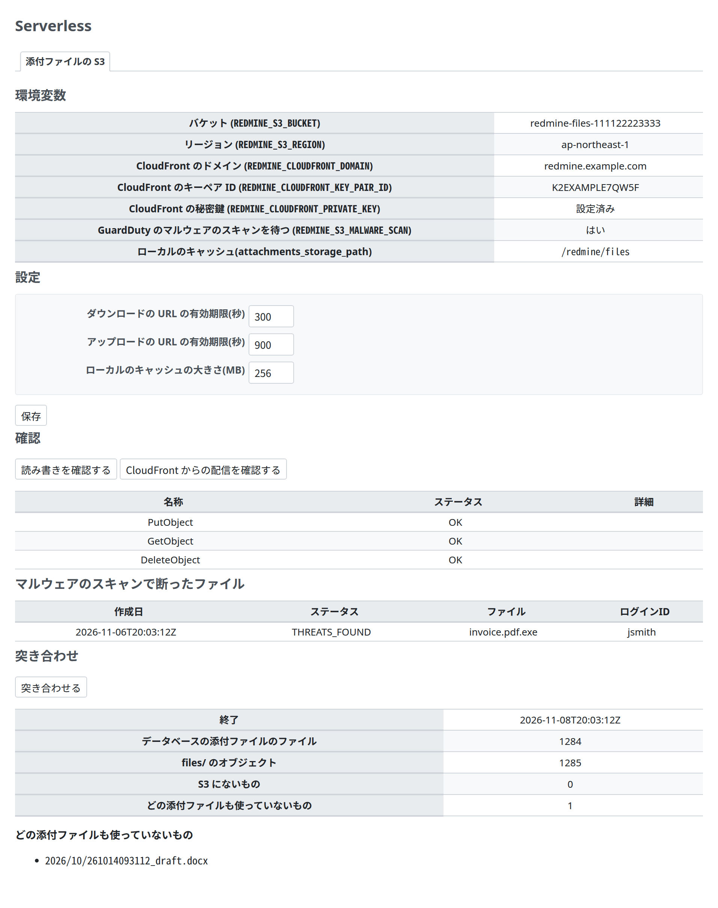

# 管理画面

Redmine Serverless S3 の管理画面です。Redmine の管理者だけが開けます(`require_admin`)。画面は、[Redmine Serverless](https://redmine-kit.github.io/redmine_serverless/ja/admin.html#the-serverless-menu) をインストールしているかどうかにかかわらず、すべての Redmine Serverless のプラグインが共有する Redmine の管理のメニューの「Serverless」の下の、「添付ファイルの S3」のタブになります。

## 添付ファイルの S3

| 項目 | 中身 | 取得元 |
| --- | --- | --- |
| 環境変数 | バケットの名前、リージョン、CloudFront のドメインとキーペアの ID、秘密鍵があるかどうか、手元のキャッシュのディレクトリ | 環境変数([setup.md](setup.md#configuration))。表示だけ。秘密鍵そのものは出さない |
| 設定 | ダウンロードとアップロードの URL の有効期限(秒)、手元のキャッシュの大きさ(MB) | プラグインの設定。画面で変える。正の整数だけ |
| マルウェアのスキャン | `REDMINE_S3_MALWARE_SCAN` が有効かどうかと、スキャンで断ったファイル(最新の 20 件。日時、状態、ファイル名、ユーザー) | 環境変数。断ったファイルはプラグインの設定に残す |
| 読み書きの確認 | 確認用のオブジェクト(`tmp/healthcheck/<UUID>`)を置いて、読んで、消す | ボタンで `PutObject`、`GetObject`、`DeleteObject` |
| 突き合わせ | データベースの添付ファイルのファイルの数と、`files/` の下のオブジェクトの数。S3 にないファイルと、どの添付ファイルも使っていないオブジェクト(それぞれ最初の 100 件) | ボタンで、`files/` を一覧するジョブ `ServerlessS3ReconcileJob` を始める。結果はプラグインの設定に残すので、どの実行環境でも最新の結果が出る |
| 配信の確認 | 確認のためのオブジェクトを置き、`/tmp/bulk/` の下の署名付き URL を作り、CloudFront を通して取る。オブジェクトが sandbox の CSP と `nosniff` 付きで返り、署名のない同じ URL が断られること | ボタンで実行する。確認のためのオブジェクトは最後に消す |

- **使い道:** 古い Redmine から添付ファイルを移したあと([migration.md](https://redmine-kit.github.io/serverless/ja/migration.html))に、突き合わせで漏れがないかを確認できます。
- **接続の確認:** Redmine Serverless を入れているときは、その接続の確認で、添付ファイルのバケットの `HeadBucket` も呼びます。
- **秘密の値は出さない:** AWS の認証情報と CloudFront の秘密鍵は画面に出しません。AWS の API は、ボタンを押したときだけ呼びます。
- **バケットがないとき:** タブは開き、`REDMINE_S3_BUCKET` がないことを出します。ボタンは出しません。
- **操作の記録:** 設定の変更、確認、突き合わせは、管理者のログイン名とともに Redmine のログに書きます。

## Serverless のメニュー

どの Redmine Serverless のプラグインも、同じ小さな共有の部分を持ちます。`lib/redmine_serverless_admin.rb`(`RedmineServerlessAdmin`)、`ServerlessAdminController`(最初のタブを開く `/admin/serverless`)、ビューの `serverless_admin/_tabs` です。Rails は最初の 1 つを読み込み、ほかは使わないので、どのプラグインを入れても、Redmine の管理のメニューの「Serverless」は 1 つだけ足されます。このプラグインは、「添付ファイルの S3」のタブを位置 50(最後)に登録し、バケットがあるときは、[Redmine Serverless](https://redmine-kit.github.io/redmine_serverless/ja/admin.html#the-serverless-menu) の接続の確認に S3 の確認(`HeadBucket`)を足します。

- **設定:** Redmine のプラグインの一覧で、このプラグインの「設定」を押すと、このタブが開きます。

## 添付ファイルサイズの上限

Redmine の「添付ファイルサイズの上限」(`attachment_max_size`、管理 › 設定 › ファイル)は、変えられるままにします。プラグインが有効なとき、設定の画面の小さなスクリプトで、この設定の横に上限の目安の説明を足します。CloudFront を通したアップロードは、`/incoming/*` の CloudFront Functions(同じ値を使う必要がある)と、1 回の PUT で CloudFront が受け付ける大きさで限られます。Lambda では、REST API の `POST /uploads.json` は 1 MB までです([attachments.md](attachments.md#upload))。

## 権限

突き合わせのジョブのために、ジョブを動かすロールに、バケットの一覧の権限を付けます。配信の確認は、添付ファイルと同じ権限を使います。一覧は [iam.md](iam.md) にあります。

## テスト

画面には Redmine の機能のテストがあります。システムのテストはまだ書いていません([testing.md](https://redmine-kit.github.io/serverless/ja/testing.html#administration-pages))。

このページの画面のスクリーンショットは、`bin/screenshots` で撮ります(Docker の中のヘッドレスの Chromium と、Redmine のテストのデータと、テストの S3。バケット、CloudFront の値、検出、突き合わせは例)。画面を変えたら実行します。
