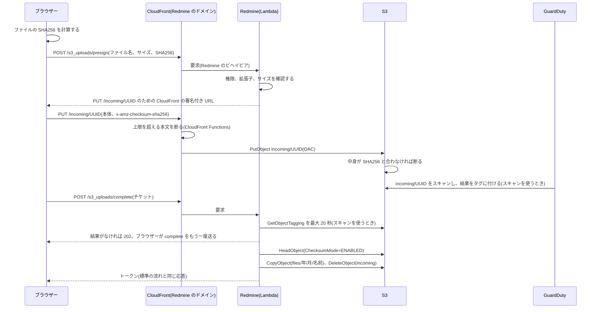
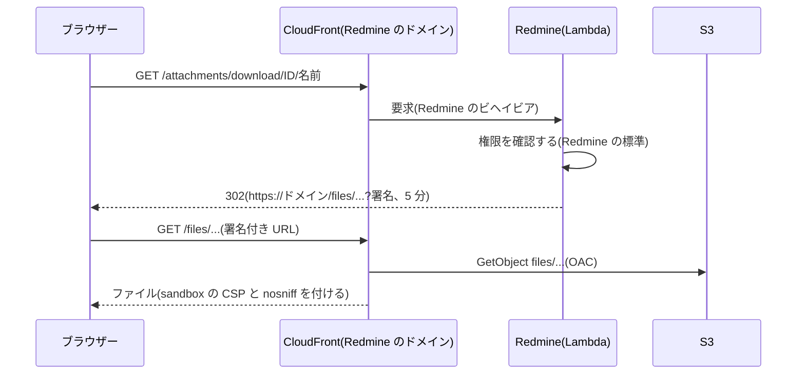
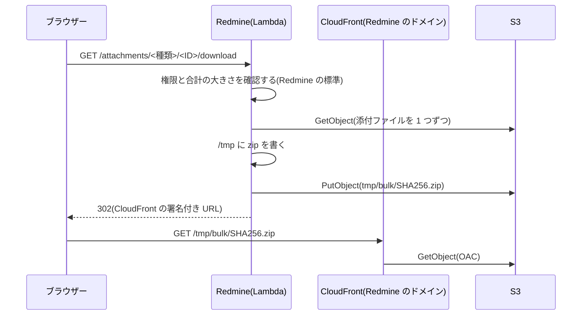

# 添付ファイルと S3

Redmine Serverless S3 が Redmine の添付ファイルを S3 に置く仕組みです。プラグインは開発の初期の段階で、本物の CloudFront のディストリビューションでまだ確認していないことは[未確認の事項](#to-verify)にあります。ブラウザーは、Redmine 自身の CloudFront のディストリビューションだけを通してファイルに触れ、S3 のドメインには触れません。アップロードは、CloudFront を通して S3 に PUT し、ブラウザーが計算した SHA256 を S3 が確認します。ダウンロードは、Redmine が権限を確認してから、`/files/` の下の署名付き URL にリダイレクトします。CloudFront が S3 からオブジェクトを読み、Redmine と同じ sandbox の CSP を付けます。ファイルの本体は Lambda を通りません。

Redmine の S3 のプラグイン(下記)のやり方を参考に、プラグイン Redmine Serverless S3(`redmine_serverless_s3`)として作ります。外部のプラグインは入れません。[Redmine Serverless](https://redmine-kit.github.io/redmine_serverless/ja/) なしで、Lambda の外でも動きます。Lambda では、[Serverless](https://redmine-kit.github.io/serverless/ja/) が両方を入れます。

この資料の仕様は、2026-11-08 時点の公式の情報と、Redmine 7.0.3 のソース(7.0-stable の d718d63)で確認したものです。出典は [sources.md](https://redmine-kit.github.io/serverless/ja/sources.html) にあります。

## Redmine の添付ファイルの仕組み

Redmine は、添付ファイルをローカルのディスクに保存します。Active Storage は使っていません(`config/application.rb` で読み込みがコメントアウトされている)。

- **保存:** `Attachment#files_to_final_location`(`app/models/attachment.rb` L146-175)が、`files/<年>/<月>/` にファイルを書き、書きながら SHA256 を計算して `digest` に入れます。ファイル名は `yymmddHHMMSS_元の名前` です。
- **digest の使い道:** 添付のトークン(`<id>.<digest>`)、ETag、サムネイルのファイル名、同じ内容のファイルの共有が、すべて `digest` に頼っています。
- **ローカルのパスを使う処理:** サムネイル(ImageMagick、Ghostscript)、Office のファイルのプレビュー(Pandoc)、PDF の出力の画像、添付の一括のダウンロード(zip)、テキストと差分の表示が、`Attachment#diskfile` のパスを読みます。
- **アップロードの流れ:** ブラウザーは、ファイルを選ぶとすぐに `POST /uploads.js` に生のバイト列を送ります(`app/assets/javascripts/attachments.js` の `uploadBlob`)。Redmine は、どこにも付いていない添付のレコードを作って、トークンを返します。チケットなどを保存するときに、トークンでレコードを付けます。
- **ダウンロードの流れ:** `AttachmentsController#download` が、権限を確認してから `send_file` でファイルを返します。

Lambda では、要求と応答が 6 MB までなので、この流れのままでは大きなファイルを扱えません。関数 URL はバイナリを base64 にするので、実際に送れるファイルは約 4.5 MB です(推測)。さらに、CloudFront を通る要求の本文は 1 MB までです([lambda.md](https://redmine-kit.github.io/serverless/ja/lambda.html#the-6-mb-limit))。

## 参考にした S3 のプラグイン

Redmine の S3 のプラグインは、どれも同じ考え方です。S3 の API で読み書きし、ダウンロードを S3 の URL にリダイレクトします。古くからある `redmine_s3`(ka8725)も、この系統です。

| プラグイン | 対応する Redmine | やり方 |
| --- | --- | --- |
| [hgyoon-w/redmine5_amazon_s3](https://github.com/hgyoon-w/redmine5_amazon_s3)(2025-12-17) | 5.0 以上 | 保存のときに S3 に PutObject。ダウンロードとサムネイルを S3 の URL にリダイレクト。サムネイルを S3 に置く。表示のテキストと差分は S3 から読む |
| [redmine_cloud_attachment_pro](https://www.redmine.org/plugins/redmine_cloud_attachment_pro)(2026-03-12) | 4.0〜6.1 | 保存のときに S3 に PutObject。`diskfile` が呼ばれるたびに、S3 から一時ファイルに取ってパスを返す |

7.0 に対応すると書いたものは、探した範囲(GitHub と redmine.org の Plugins の「s3」の検索)では見つかりませんでした。

### プラグインと変えるところ

| 項目 | プラグイン | このプラグイン | 理由 |
| --- | --- | --- | --- |
| アップロード | Rails が受けて S3 に送る | ブラウザーが CloudFront を通して S3 に PUT し、S3 が SHA256 を確認する | Lambda の 6 MB の制限 |
| ダウンロード | S3 の署名付き URL にリダイレクトする | Redmine のドメインの CloudFront の署名付き URL(`/files/...`)にリダイレクトし、S3 から返す | Redmine が添付ファイルに付ける sandbox の CSP を、S3 では付けられない(下記) |
| digest | hgyoon-w のものは、保存の時刻に置き換える | SHA256 のまま | トークン、ETag、サムネイル、同じ内容の共有が digest に頼っている |
| ローカルのパスを使う処理 | `diskfile` のたびに S3 から取る(cloud_attachment_pro) | `/tmp` にキャッシュして使い回す | 同じ環境での取り直しを減らす。ファイルは一度保存したら変わらないので、キャッシュが古くならない |
| CSV のインポート | 対応していない | インポートのファイルも S3 に置く | インポートは複数の要求にまたがり、別の環境に届くことがある |

## 検討した方法

| 方法 | 判断 |
| --- | --- |
| S3 の API で読み書きする(プラグインのやり方) | 使う |
| S3 Files で S3 のバケットを `files/` にマウントする | 使わない。アップロードとダウンロードをブラウザーと S3 のあいだで行うと、残る利点はサーバーでの処理(サムネイルなど)だけになる。そのために、ファイルシステムと S3 のあいだの同期(書き込みから S3 に出るまで 60 秒ほど)と、追加の料金(載っているデータ 1 GB あたり月 0.36 ドル)を抱えることになる |
| EFS をマウントする | 使わない。S3 に置くという要件に合わない |

## バケットの構成

バケットは 1 つです(この資料では `redmine-files` と書きます。インスタンスの名前が `redmine` のときの例で、本当の名前は [deploy-config.md](https://redmine-kit.github.io/serverless/ja/deploy-config.html#names-derived-from-the-instance-name) の決まりで作ります)。

| キー | 中身 | 消すとき |
| --- | --- | --- |
| `files/<年>/<月>/<ファイル名>` | 添付ファイル。Redmine の `disk_directory` と `disk_filename` と同じ形 | Redmine が添付を消したとき |
| `thumbnails/<digest>_<サイズ>_<幅>.thumb` | サムネイル。名前は Redmine と同じ規則 | 元の添付を消したとき |
| `tmp/bulk/<SHA256>.zip` | 添付の一括のダウンロードの zip。名前は添付ファイルの ID と digest の SHA256 | ライフサイクルで 1 日 |
| `imports/<ファイル名>` | CSV のインポートのファイル。Redmine が付ける名前(16 進) | インポートが終わったとき。残ったものはライフサイクルで 7 日 |
| `incoming/<UUID>` | ブラウザーが送ったファイル(登録の前) | 登録したとき。残ったものはライフサイクルで 1 日 |

- **バージョニング:** 有効にします。ファイルを消すと削除マーカーになり、古いバージョンはライフサイクルで 30 日後に消します。誤って消したファイルを、30 日のあいだは戻せます。
- **暗号化:** SSE-S3(S3 の既定)にします。
- **公開しない:** アカウント全体で S3 のパブリックアクセスをブロックしています。バケットポリシーで、TLS でない要求を断り、Redmine の CloudFront のディストリビューションには、そのオリジンアクセスコントロール(OAC)を通したものだけ、`files/`、`thumbnails/`、`tmp/bulk/` の読み取りと、`incoming/` への書き込みを許します([setup.md](setup.md#the-bucket))。
- **CORS は要らない:** ブラウザーは Redmine 自身のドメインだけを使うので、バケットに CORS の設定は要りません。
- **バケットに届くもの:** OAC を通した CloudFront と、Redmine を動かすプロセスのロールだけです。ブラウザーに S3 の署名付き URL は渡しません。

## アップロード

すべてのファイルを、ブラウザーから Redmine の CloudFront のディストリビューションを通して、S3 に PUT します。ブラウザーがファイルの SHA256 を計算して PUT に付け、中身が合わなければ S3 がアップロードを断ります。そのあと Redmine は、ファイルを読まずに、S3 が確認したチェックサムを読みます。

1. **ブラウザーで SHA256 を計算する:** ブラウザーが、ファイルを 4 MB ずつ読みながら、プラグインが持つ JavaScript の SHA-256(`assets/javascripts/s3_upload.js`、外部のライブラリなし)で SHA256 を計算します。Web Crypto(`crypto.subtle.digest`)は、ファイル全体をメモリに読む必要があるので使いません。Redmine の進み具合のバーは、前半で計算を、後半で PUT を表します。
2. **署名付き URL を受け取る:** `POST /s3_uploads/presign` を足します。ファイル名、サイズ、SHA256(base64)を受け取ります。同一オリジンなので、rails-ujs が CSRF のトークンを付けます。権限は、標準のアップロードと同じもの(`authorize_global`)を確認します。拡張子は `Attachment.valid_extension?` で、サイズは Redmine の添付の上限(`attachment_max_size`)で確認します。Redmine は、ちょうど `https://<ドメイン>/incoming/<UUID>` だけに効く既定ポリシー(canned policy)の CloudFront の署名付き URL と、チケットを返します。URL の期限は 15 分です。チケットは、キー、申告されたファイル名、サイズ、SHA256、コンテンツタイプと、ユーザーを、Rails の message verifier(`secret_key_base`)で署名したもので、URL と同じときに期限が切れます。2 つの要求のあいだで Redmine は状態を持たないので、2 つが別の実行環境に届いてもかまいません。
3. **CloudFront を通して PUT する:** ブラウザーが、`x-amz-checksum-sha256: <base64>` のヘッダーを付けて、署名付き URL にファイルを PUT します。キャッシュビヘイビアの `/incoming/*` は、PUT を許し、署名付き URL を必須にし、キャッシュせず、`x-amz-checksum-sha256` のヘッダーを、OAC で S3 に渡します。署名付き URL では大きさを限れないので、ビューワーリクエストの CloudFront Functions が、`Content-Length` がアップロードの上限を超える要求を断ります。S3 は中身をチェックサムと照らし、合わなければ PUT を断ります(CloudFront を通したときのことは、まだ確認していない)。
4. **登録する:** チケットを受け取る `POST /s3_uploads/complete` を足します。チケットは、正しく、期限内で、いまのユーザーのものである必要があります。マルウェアのスキャンを使うときは、まずその結果を待ちます([下記](#malware-scan))。Redmine は `ChecksumMode=ENABLED` で `HeadObject` を呼びます。`ChecksumSHA256`(`ChecksumType` が `FULL_OBJECT`)と `ContentLength` が、手順 2 で申告された SHA256 とサイズに等しくなければ、オブジェクトを消して登録を失敗させます。オブジェクトは読みません。SHA256(base64 を 16 進に直したもの)を digest にします。同じ digest とサイズの添付がすでにあれば、そのファイルを共有し、送られたオブジェクトは消します(Redmine の `reuse_existing_file_if_possible` と同じ考え方)。なければ `files/<年>/<月>/<ファイル名>` にコピーし、`incoming/` のオブジェクトを消します。ファイル名は Redmine と同じ作り方(`yymmddHHMMSS_` と名前。ASCII でない名前はそのハッシュ)で、S3 とデータベースで重ならないものにします。そのうえで、添付のレコードを `disk_directory`、`disk_filename`、`digest`、`filesize` を指定して作ります。ファイルの本体を Redmine に渡さないので、`files_to_final_location` は何もしません。
5. **トークンを返す:** 応答は、標準の `POST /uploads.js` と同じテンプレート(`attachments/upload.js.erb`)で返します。ブラウザーの側は、標準の流れと同じくトークンをフォームに入れます。

- **POST でなく PUT にする理由:** オリジンアクセスコントロールは、CloudFront が S3 に送る要求に署名し、PUT に対応しています。S3 の POST のフォームのポリシーには署名できないので、CloudFront を通した POST は使いません(AWS のブログ「Implementing secure file uploads to Amazon S3 at the edge: Choosing the right pattern」、2026-02-24、と CloudFront の S3 のオリジンの資料)。
- **ブラウザーの側:** プラグインの JavaScript が `attachments.js` の `uploadBlob` を差し替え、アップロードの前にハッシュを計算します。キュー、進み具合の表示、トークンの扱いは標準のままで、エラーは Redmine が出す場所に出ます。JavaScript は、プラグインが有効なときだけ、Redmine のビューのフック(`view_layouts_base_html_head`)で読み込み、2 つの URL は `<meta>` のタグで渡します。`attachments.js` は Ajax で届くフォームと一緒に読み込み直されることがあるので、ファイルを選ぶ、落とす、貼り付けるたびに、差し替えを戻します。
- **REST API:** `POST /s3_uploads/presign.json` と `POST /s3_uploads/complete.json` は、Redmine の `POST /uploads.json` と同じく API キーを受け付けます。クライアントは、返された URL に、返されたヘッダーを付けてファイルを PUT します。`complete.json` は、`/uploads.json` と同じ `upload`(`id`、`token`)を返します。
- **ブラウザーの値だけを信用しない:** digest は、S3 が送られたバイトと照らした値で、手順 2 の申告と等しい必要があります。ほかのファイルの SHA256 を申告して、その中身を共有させようとしても、中身が合わないので S3 で失敗します。
- **ファイルの大きさの上限:** 登録のときに Redmine がファイルを読まないので、Lambda のタイムアウトで大きさは限られません。上限は、CloudFront Functions で守る Redmine の `attachment_max_size` と、1 回の PUT で CloudFront が受け付ける大きさです(資料に見つからない。確認すること)。大きなファイルは、ブラウザーでのハッシュの計算に時間がかかります。
- **WAF:** 同じ WAF がアップロードにも効きます。WAF が調べる大きさを超える本文には、`/incoming/*` に当てるルールの、大きすぎる本文の扱いか、範囲の絞り込みが要ります。`SizeRestrictions_BODY` のルールがアップロードを止めないようにします(確認すること)。
- **本文のハッシュ:** 本文のハッシュを入れる Lambda@Edge は、Redmine のビヘイビアだけに付けます([lambda.md](https://redmine-kit.github.io/serverless/ja/lambda.html#function-that-adds-the-body-hash-lambdaedge))。`/incoming/*` は、Lambda ではなく S3 に届きます。

### Lambda を通るアップロード

次の経路は、ファイルが Rails に届きます。

- REST API の `POST /uploads.json`(1 MB まで)
- File API のないブラウザーのフォームの送信(1 MB まで)
- メールで受けた添付ファイル(S3 から `redmine-task` が読むので、CloudFront と関数 URL の制限は当たらない)

CloudFront を通る要求の本文は、本文のハッシュを入れる Lambda@Edge が読める 1 MB までです([lambda.md](https://redmine-kit.github.io/serverless/ja/lambda.html#the-6-mb-limit))。大きなファイルを API で送るときは、CloudFront を通したアップロード(上の流れ。API キーと OAuth でも使える)を使います。

これらは、Redmine の標準の `files_to_final_location` で `/tmp` のキャッシュ(下記)に書いたあと、S3 に PutObject します。PutObject が失敗したら、例外を発生させ、レコードを保存しません。マルウェアのスキャンを使うときは、代わりに `incoming/<UUID>` に置き、スキャンを最大 20 秒待って、問題がなかったときだけ `files/` にコピーします。そうでなければ、添付ファイルを検証のエラーにして保存しません。受信したメールの添付ファイルは待ちません(下記)。

## マルウェアのスキャン

Amazon GuardDuty Malware Protection for S3 で、ユーザーが送ったファイルを、Redmine が使う前にスキャンできます。既定では使わないので、GuardDuty がなくてもプラグインは動きます。`REDMINE_S3_MALWARE_SCAN=true` で、結果を待つようにします([setup.md](setup.md#configuration))。

- **スキャンするもの:** 添付ファイルのバケットの Malware Protection のプランが、`incoming/`(アップロード)と `imports/`(CSV のインポートのファイル)の下の新しいオブジェクトをスキャンし、`GuardDutyMalwareScanStatus` のタグを付けます。値は `NO_THREATS_FOUND`、`THREATS_FOUND`、`UNSUPPORTED`、`ACCESS_DENIED`、`FAILED` のどれかです。
- **待ち方:** Redmine は、1 回の要求のなかで、`GetObjectTagging` で 1 秒ごとに、最大 20 秒タグを読みます。
- **CloudFront を通したアップロード:** `POST /s3_uploads/complete` は、タグが `NO_THREATS_FOUND` のときだけファイルを登録します。まだタグがなければ、オブジェクトを残して `202`(`{"status":"scanning"}`、`Retry-After: 2`)を返します。ブラウザーは、1、2、4、8、15、30 秒後に同じ要求を送り直し、それでも終わらなければ、まだスキャン中だと出します。REST API のクライアントにも `202` を返すので、`complete.json` を送り直します。
- **断るファイル:** `THREATS_FOUND` なら、オブジェクトを消し、「マルウェアのスキャンで脅威が見つかった」としてファイルを断ります。`UNSUPPORTED`、`ACCESS_DENIED`、`FAILED` も、状態を添えて同じように断ります。断ったファイルは、ログに書き、[管理画面](admin.md#attachments-in-s3)に出します(最新の 20 件)。
- **Lambda を通るアップロード:** 先に `incoming/` に置きます([上記](#uploads-through-lambda))。20 秒たっても結果がなければ、「まだスキャン中」としてアップロードを失敗させるので、送り直します。
- **受信したメール:** 受信したメールの添付ファイルは、SES が独自にウイルスを判定するので([mail.md](https://redmine-kit.github.io/serverless/ja/mail.html#receiving))、待たずに `files/` に置きます。
- **CSV のインポート:** インポートのファイルは、タグが `NO_THREATS_FOUND` になってから読みます。断ったファイルは消し、Redmine はファイルを読めないと出します。
- **バケットポリシー:** オブジェクトのタグが `NO_THREATS_FOUND` でなければ、`incoming/*` と `imports/*` の `GetObject`(つまり `HeadObject` と `CopyObject` のコピー元)を拒みます。GuardDuty のロールは除きます([iam.md](iam.md#resource-based-policies))。待たないコードがあっても、問題がないとわかる前にファイルが読まれることはありません。
- **費用:** 東京(ap-northeast-1)で、スキャンした量 1 GB あたり 0.1185 USD(毎月最初の 1 GB は無料)と、オブジェクト 1 つあたり 0.000282 USD(毎月最初の 1,000 は無料)です(2026-10-30 の AWS の価格表)。スキャンするのは `incoming/` と `imports/` だけなので、サムネイル、zip、`files/` にコピーしたオブジェクトは、もう一度スキャンしません。

## ダウンロード

すべてのダウンロードを、Redmine 自身のドメインの、CloudFront の署名付き URL へのリダイレクトにします。Redmine の CloudFront のディストリビューションに、S3 のキーのプレフィックスをパスのパターンにしたキャッシュビヘイビアを足し、そのパスは添付ファイルのバケットから返します。

1. Redmine の標準の確認(ログイン、プロジェクトの権限)を通します。
2. ダウンロードの回数を数えます(バージョンとプロジェクトのファイル。Redmine の標準と同じ)。
3. CloudFront の署名付き URL `https://<ドメイン>/files/<年>/<月>/<ファイル名>?...`(期限 5 分)に、302 でリダイレクトします。クエリーの `response-content-disposition` と `response-content-type` で、Redmine と同じファイル名と表示のしかたを指定します。Redmine は、PDF だけを `inline`、ほかを `attachment` にします(`AttachmentsController#disposition`)。
4. CloudFront が署名を確認し、パスをキーにして、OAC で S3 からオブジェクトを読みます。2 つのクエリーは S3 に渡します。返すときは、これらのビヘイビアのレスポンスヘッダーポリシーのヘッダーを付けます。

- **キャッシュビヘイビア:** `/files/*`、`/thumbnails/*`、`/tmp/bulk/*` は、OAC で添付ファイルのバケットに送ります。ほかのパスは、今までどおり Redmine に送ります。閲覧する側には、ディストリビューションの信頼されたキーグループの鍵で作った署名付き URL が要ります。クエリーの `response-content-disposition` と `response-content-type` は S3 に渡し、キャッシュのキーにも入れます。Cookie と `Authorization` のヘッダーは渡しません。S3 がこの上書きを受け付けるのは署名のある要求だけで、OAC からの要求には署名があります(まだ確認していない)。
- **Redmine のパスと重ならない:** Redmine には、`/files`、`/thumbnails`、`/tmp` で始まるルートはありません。添付ファイルは `/attachments/...`、プロジェクトのファイルは `/projects/<id>/files` です。`public/` にも、その名前のディレクトリはありません(2026-11-09 に Redmine 7.0.3 の `config/routes.rb` で確認)。
- **CSP:** これらのビヘイビアのレスポンスヘッダーポリシーで、`Content-Security-Policy: default-src 'none'; style-src 'unsafe-inline'; sandbox` と `X-Content-Type-Options: nosniff` を付けます。CSP は、Redmine の `AttachmentsController` が添付ファイルを返すときに付けるのと同じ値です(2026-11-09 に Redmine 7.0.3 のコードで確認)。Redmine のビヘイビアは、今のレスポンスヘッダーポリシーのままです。
- **Redmine と同じオリジン:** 添付ファイルは、Redmine の標準と同じく、Redmine のオリジンから返ります。それを切り離すのは sandbox の CSP です。sandbox の文書は不透明なオリジンになり、スクリプトも動かないので、HTML や SVG の添付ファイルは、Redmine の Cookie を読むことも、Redmine を呼ぶこともできません。そのため、このヘッダーは必ず付いている必要があります。デプロイのあとの確認で、`/files/` の下の応答に sandbox の CSP と `nosniff` が付いていることを確認します([testing.md](https://redmine-kit.github.io/serverless/ja/testing.html#checks-after-deployment))。
- **CloudFront を使う理由:** S3 の署名付きの GET で上書きできるのは、`response-content-type`、`-language`、`-expires`、`-cache-control`、`-disposition`、`-encoding` だけです。ほかのヘッダーは足せないので、CSP を S3 から付けることはできません。
- **ディストリビューションは 1 つ:** 2 つめのディストリビューション、証明書、DNS のレコードは要りません。Redmine のディストリビューションの WAF が、添付ファイルにも効きます。
- **ファイルがあるかの確認:** Redmine は、ダウンロードの前にローカルのファイルがあるかを確認します(`file_readable`、`Attachment#readable?`)。この確認は、手元のキャッシュのファイル、なければ S3 の HeadObject に替えます。
- **画像の表示:** wiki やチケットの本文の画像(`/attachments/download/<id>/<名前>`)も、同じリダイレクトで表示されます。`` は、`attachment` の指定があっても画像を表示し、sandbox の CSP も画像の表示は止めません。画像の数だけ Lambda が呼ばれるので、画像の多いページでは、同時の要求の数だけ環境が起動します(推測。作ったあとで測る)。
- **署名:** 署名付き URL は、信頼されたキーグループの秘密鍵で作ります。Redmine はこの鍵を SSM Parameter Store から読みます([setup.md](setup.md#configuration))。URL は 5 分のあいだ有効で、プロセスの認証情報には左右されません。

### サムネイル

Redmine の標準のままにします。サムネイルの画像は、Redmine の標準のパス(`/attachments/thumbnail/<id>/<幅>`)で、必要になったときに作ります(Redmine の既定でサムネイルは有効。`thumbnails_enabled`)。

- **作る:** そのパスに初めて届いたときに、S3 から元のファイルを `/tmp` のキャッシュに取り、Redmine の標準の `Redmine::Thumbnail.generate` で作って、`thumbnails/` に PutObject します。キャッシュの上限(256 MB)より大きな画像はサムネイルを作らず、Redmine の標準のアイコンを出します。
- **返す:** `/thumbnails/` の下の、CloudFront の署名付き URL(期限 5 分)にリダイレクトします。応答のヘッダーは、ダウンロードと同じです。
- **ブラウザーのキャッシュ:** リダイレクトの応答に `Cache-Control: private, max-age=300` を付けます。同じ画面を 5 分のうちに開き直しても、Lambda を呼びません。
- **同時の要求:** 1 つの画面に多くのサムネイルがあると、その数だけ同時に Lambda が呼ばれ、環境が増えます。`redmine-web` の同時実行数の予約(10)を超えると、超えた分は断られます。サムネイルの多い画面で測り、足りなければ同時実行数の予約を増やします。それでも足りないときは、HTML に署名付き URL を直接書く形(S3 のプラグインのやり方)を考えます。

### テキスト、差分、プレビュー

- **テキストと差分の表示:** Redmine の標準のままです。`Attachment#diskfile` が `/tmp` のキャッシュのパスを返すので、標準の表示(`AttachmentsController#show`)がそのまま動きます。表示する大きさは `file_max_size_displayed`(既定 512 KB)までです。
- **Office のファイルのプレビュー(Pandoc)、PDF の出力の画像:** ローカルのパスが要るので、`/tmp` のキャッシュから読みます。
- **添付の一括のダウンロード(zip):** S3 に仮のファイルとして作り、`/tmp/bulk/` の下の、CloudFront の署名付き URL にリダイレクトします(下記)。

### 添付の一括のダウンロード

Redmine は、チケットなどの添付ファイルをまとめて zip で返します(`AttachmentsController#download_all`)。標準では、zip をメモリで作り(`Attachment.archive_attachments`)、そのまま応答で返すので、Lambda の応答の 6 MB の制限に当たります。そこで、zip を S3 の仮のファイルとして作り、`/tmp/bulk/` の下の、CloudFront の署名付き URL にリダイレクトします。

1. **確認する:** Redmine の標準の確認(添付ファイルが見えるか、合計が `bulk_download_max_size` を超えないか)を、そのまま通します。
2. **作る:** 添付ファイルを S3 から 1 つずつ読みながら、`/tmp` に zip を書きます。Redmine の標準のように、すべてのファイルをメモリに読みません。
3. **置く:** zip を、1 回の PutObject で `tmp/bulk/<SHA256>.zip` に置きます(`bulk_download_max_size` があるので、1 回の PUT の上限の 5 GB よりずっと小さい)。`/tmp` の zip は消します。
4. **返す:** CloudFront の署名付き URL(期限 5 分)に 302 でリダイレクトします。ファイル名は Redmine と同じ(`<種類>-<ID>-attachments.zip`)にし、`response-content-disposition` で `attachment` にします。

- **上限:** `bulk_download_max_size` は、Redmine の既定(100 MB)のままにします。zip を作る時間が、`redmine-web` のタイムアウト(60 秒)に収まるかを測り、収まらなければ下げます。
- **仮のファイルを消す:** `tmp/` の下は、ライフサイクルで 1 日後に消します。
- **ほかの出力:** チケットの一覧の CSV や PDF、wiki の HTML などの出力は、Redmine から、そのまま返します。チケットの出力は既定で 500 件まで(`issues_export_limit`)で、ほかの出力も文字が中心で圧縮されるので、6 MB に届かない見込みです([lambda.md](https://redmine-kit.github.io/serverless/ja/lambda.html#the-6-mb-limit))。
- **作り直さない:** 同じ添付ファイルの組み合わせ(添付ファイルの ID と digest から作るキー)の zip が、まだ `tmp/bulk/` にあれば、作り直さずにリダイレクトします。
- **ファイルがあるかの確認:** Redmine は、添付ファイルごとに `readable?` で確認します。`readable?` は、手元のキャッシュにファイルがあればそれを使い、なければ添付ファイルごとに S3 の HeadObject を 1 回送ります(添付ファイルが多いときの時間はまだ測っていない)。

## /tmp のキャッシュ

Redmine の `attachments_storage_path` を `/tmp/redmine/files` にし、ここを S3 のキャッシュとして使います。

- **パスの形:** `/tmp/redmine/files/<年>/<月>/<ファイル名>` で、S3 のキー(`files/<年>/<月>/<ファイル名>`)と同じ形です。`Attachment#diskfile` は、Redmine の標準のまま使えます。
- **S3 からの取得:** `Attachment#diskfile` を差し替え、パスを返す前に次のように判断します。
  - ローカルにファイルがあれば、そのパスを返します。保存の途中(`files_to_final_location` がファイルを作ったあと)もこれに当たり、S3 には取りに行きません。
  - ローカルになく、レコードが保存済みなら、S3 から取ってからパスを返します。別の名前で書いてから名前を変えるので、途中のファイルを読むことはありません。
  - 削除(`delete_from_disk!`)と、ファイルがあるかの確認(`readable?`)は、`diskfile` を通さないように差し替えます。消すだけのファイルや、確認するだけのファイルを取りに行かないためです。
- **古くならない:** 添付ファイルは一度保存したら変わらないので、キャッシュを確認直す必要はありません。
- **大きさ:** 関数の `/tmp` は、Lambda の既定の 512 MB です。添付ファイルのキャッシュは 256 MB までとし、超えたら古いものから消します。環境が消えると、キャッシュも消えます。
- **512 MB で足りる理由:** 登録のときに Lambda がオブジェクト全体を読まず(SHA256 は S3 が確認する)、ダウンロードは Lambda を通りません。`/tmp` を使うのは、Redmine 自身がファイルを読むときだけです。サムネイル(元の画像)、`file_max_size_displayed`(既定 512 KB)までのテキストと差分の表示、Office のプレビュー、`bulk_download_max_size`(既定 100 MB)までの一括のダウンロードの zip(元のファイルと zip を合わせて最大 200 MB ほど)、CSV のインポート、受けたメールの添付ファイル、PDF の出力です。
- **CSV のインポート:** インポートのファイルも、`/tmp/redmine/imports` に書いたあと `imports/` に PutObject し、読むときにローカルになければ S3 から取ります。`Import#filepath` は `Rails.root/tmp/imports` に固定されているので、イメージの `tmp` を `/tmp/redmine` へのシンボリックリンクにします([lambda.md](https://redmine-kit.github.io/serverless/ja/lambda.html#read-only-file-system))。
- **Office のファイルのプレビューのキャッシュ:** Redmine は `files/derived_cache/` に置きます。`/tmp` のキャッシュの中に置き、S3 には置きません。環境ごとに作り直します。

## 削除

- **添付ファイル:** Redmine は、同じファイルを参照するほかの添付がないときだけ、ファイルを消します(`delete_from_disk`)。この判断はそのまま使い、消す処理(`delete_from_disk!`)を差し替えて、S3 の `files/...` と、`thumbnails/<digest>_<サイズ>_` で始まるサムネイルを消します。`/tmp` のキャッシュも消します。
- **同じ内容のファイルの共有:** Redmine の `reuse_existing_file_if_possible` は、ローカルのファイルを比べます。digest(SHA256)とサイズが同じかで判断するように差し替え、新しい方の S3 のオブジェクトを消します。
- **どこにも付いていない添付:** 毎日、タスク用の関数で `redmine:attachments:prune` を実行します。1 日以上たったものを、Redmine の削除の流れで消します。

## 差し替える処理

Redmine 本体のファイルは書き換えず、プラグインから `prepend` で差し替えます。足す画面(`/s3_uploads/presign`、`/s3_uploads/complete`)は、プラグインのルートとコントローラーに置きます。

| 対象 | 差し替え | 理由 |
| --- | --- | --- |
| `Attachment#files_to_final_location` | 標準の処理のあと、S3 に PutObject する | Lambda を通るアップロード |
| `Attachment#readable?` | S3 の HeadObject | ダウンロードの前の確認 |
| `Attachment#thumbnailable?` | 手元のキャッシュより大きいファイルにはサムネイルを作らない | `/tmp` の上限 |
| `Attachment#diskfile` を使う処理 | 使う前に `/tmp` のキャッシュに取る | サムネイル、プレビュー、PDF、zip |
| `Attachment#delete_from_disk!` | S3 から消す | 削除 |
| `Attachment#reuse_existing_file_if_possible` | digest とサイズで比べる | 同じ内容の共有 |
| `Attachment#thumbnail` | S3 にあればそれを使い、なければ作って置く | サムネイル |
| `AttachmentsController#download` `#thumbnail` | CloudFront の署名付き URL にリダイレクト(サムネイルは `Cache-Control` を付ける) | ダウンロード、サムネイル |
| `AttachmentsController#download_all` | zip を `/tmp` に書いて S3 の仮のファイルに置き、CloudFront の署名付き URL にリダイレクトする | 添付の一括のダウンロード |
| `Import#file=` `#file_exists?` `#remove_file` | S3 に置き、なければ S3 から取り、S3 から消す | CSV のインポート |
| `MailHandler#receive` | 受信したメールの添付ファイルでは、マルウェアのスキャンを待たない | [マルウェアのスキャン](#malware-scan) |
| `SettingsController#plugin`(このプラグインの GET だけ) | 「添付ファイルの S3」のタブにリダイレクトする | プラグインの一覧の「設定」([admin.md](admin.md)) |
| `attachments.js` の `uploadBlob` | SHA256 を計算し、その値を付けて CloudFront の署名付き URL に PUT する | アップロード |

- **有効にする条件:** S3 のバケットの設定(`REDMINE_S3_BUCKET`)があるときだけ、差し替えを有効にします。設定がなければ、Redmine の標準のままに動きます。Redmine 本体のテストを、そのまま通せるようにするためです([testing.md](https://redmine-kit.github.io/serverless/ja/testing.html#redmines-own-tests))。
- **Redmine の更新:** Redmine のバージョンアップのときは、差し替えた処理の元のコードが変わっていないかを確認します。差し替えの一覧は、この表を正とします。元のコードが変わったら、テストが失敗します。`test/unit/replaced_code_test.rb` が、この表のメソッドと、プラグインがコピーした Redmine のコード(`Attachment.create_diskfile`、`Attachment.archive_attachments`、`Attachment#thumbnail` のサムネイルの大きさ)の SHA256 を、Redmine 7.0.3 のものと比べます([testing.md](https://redmine-kit.github.io/serverless/ja/testing.html#redmines-own-tests))。
- **テスト:** 差し替えた処理ごとに、Redmine のテストの仕組みでテストを書きます([setup.md](setup.md#what-the-tests-check))。

## 権限

プラグインを入れた Redmine を動かすプロセスには、どれも、添付ファイルのバケットのプレフィックスごとの読み書きを付け、CloudFront の署名付き URL のための秘密鍵を読ませます。一覧とポリシーの例は [iam.md](iam.md)、Serverless のロールは [iam.md](https://redmine-kit.github.io/serverless/ja/iam.html) にあります。Serverless では、Lambda は VPC の中で動き、S3 のゲートウェイエンドポイント(無料)を通って S3 に届きます。Lambda の外では、バケットに同じ操作を許す認証情報が、プロセスに要ります。

## 未確認の事項

- CloudFront(OAC)を通した PUT の中身が `x-amz-checksum-sha256` と合わないときに S3 が断ること、合うときに `HeadObject` が `ChecksumSHA256` と `ChecksumType` の `FULL_OBJECT` を返すこと
- S3 のオリジンへの PUT で、CloudFront が受け付ける要求の本文の大きさ(資料に見つからない)、オリジンの応答のタイムアウト(既定 30 秒)が大きなアップロードにどう効くか
- 大きなアップロードの本文での WAF(大きすぎる本文の扱い、範囲の絞り込み、`SizeRestrictions_BODY`)
- CloudFront の定額のプランで、アップロードの通信がどう数えられるか
- 大きなファイル(1 GB など)で、ブラウザーでのハッシュの計算にどれだけかかるか。プラグインの SHA-256 は、テストの Node.js 26 で毎秒およそ 100 MB でした(2026-11-09)
- CloudFront から OAC を通した要求で、S3 が `response-content-disposition` と `response-content-type` を受け付けるか、日本語のファイル名が正しく保存されるか(`response-content-disposition` の書き方)
- 2 つのクエリーをキャッシュのキーに入れたときに、CloudFront が署名付き URL をどうキャッシュするか
- `uploadBlob` を差し替えたときに、貼り付けた画像とドラッグ・アンド・ドロップが標準と同じに動くか
- エラー(サイズの超過、チェックサムが合わないなど)の表示
